# PAVÉ

A top-down open-world crime caper on the real streets of Paris and Copenhagen,
written in **Ada 2012 + GtkAda** (Cairo rendering). Map data © OpenStreetMap contributors (ODbL).

> **Made only by prompting.** Everything in this repository (the Ada game, the sound synthesizer,
> the map tools, this README and its screenshots) was created by prompting Claude Opus 5.5
> (Anthropic) in Claude Code. No code was written by hand.

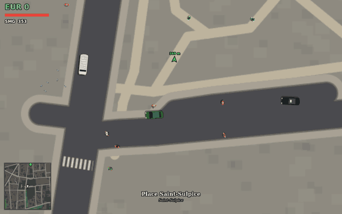

| | |
| --- | --- |
| 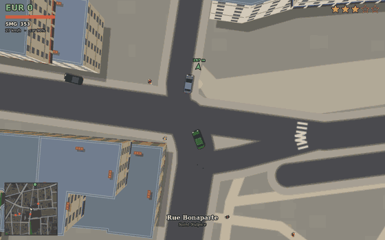 | 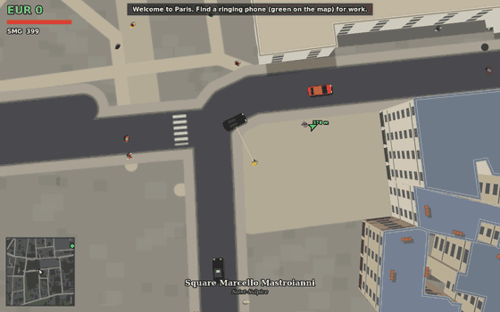 |
| Three stars: a police chase onto Boulevard Saint-Germain | Things go wrong at Place Saint-Sulpice |
| 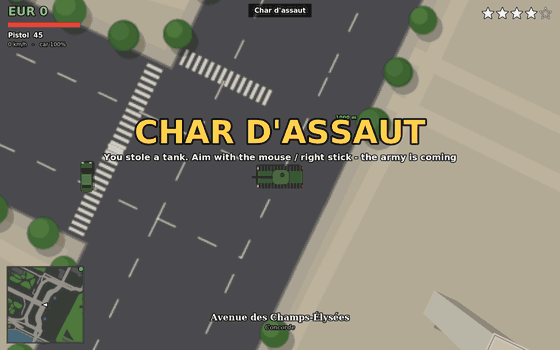 | 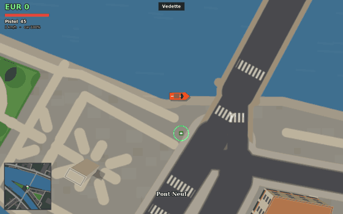 |
| Borrowing a tank on Place de la Concorde | A speedboat on the Seine at Pont Neuf |
| 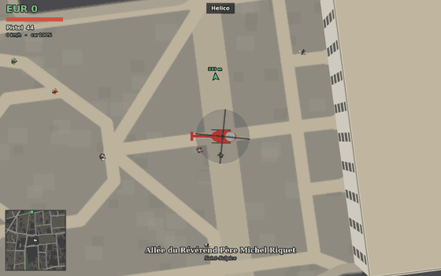 | 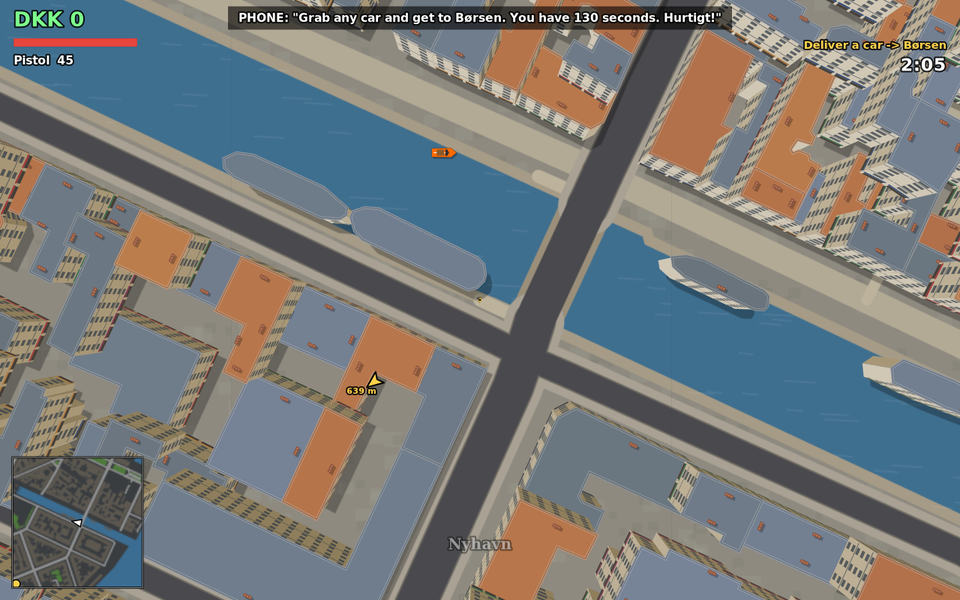 |
| Lift-off over Saint-Sulpice | Copenhagen: Nyhavn, with a tour boat on the canal |
| 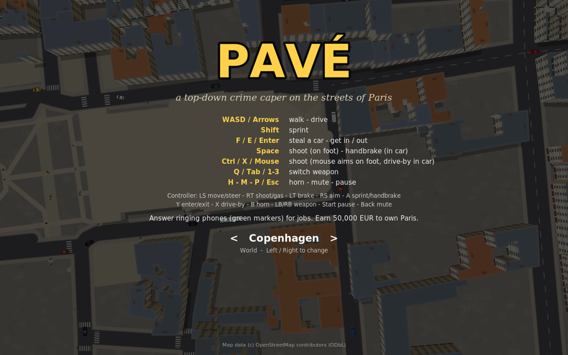 | 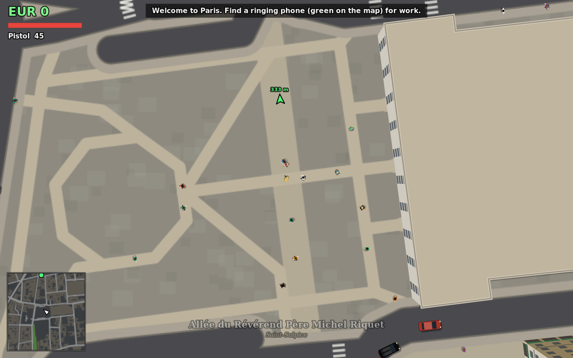 |
| Title screen | The game starts at Place Saint-Sulpice |

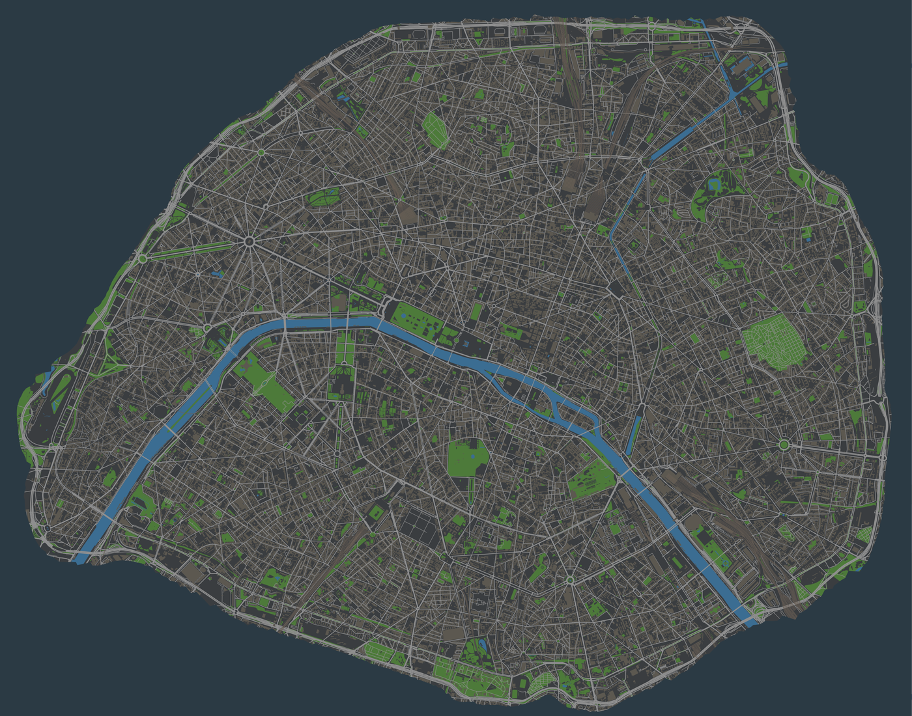

*The All of Paris world, as on the in-game minimap: 86,000 buildings, the Seine, the canals,
parks and railways, with the Périphérique as the edge of the world.*

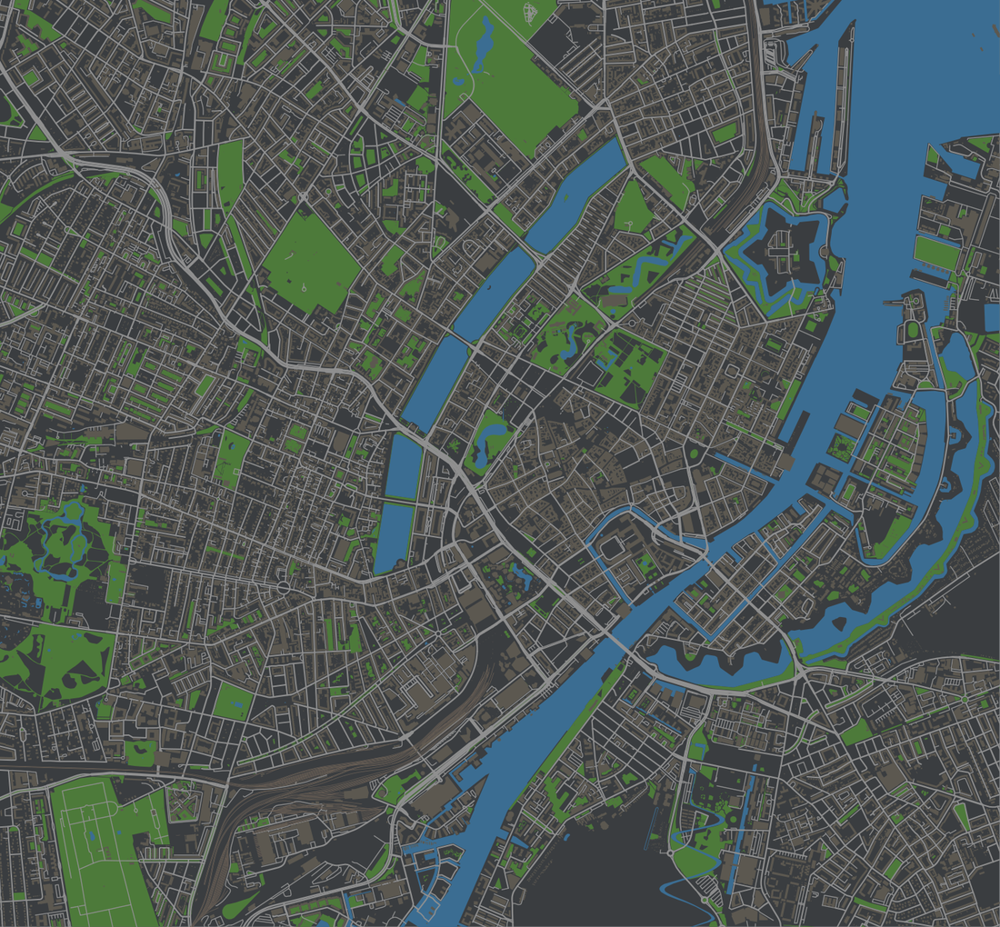

*Copenhagen: the harbour and its islands come from OpenStreetMap's coastline; Christianshavn's
canals, the star-shaped Kastellet and the Lakes are all there.*

## Build & run

Requires GNAT, gprbuild, GtkAda and the PulseAudio client library, plus `python3` for
downloading maps and preferably `python3-pyosmium` (see below). Sound plays through PulseAudio
(or PipeWire's Pulse server); without one the game runs silently.

```sh
git clone <this repository> && cd <it>
make            # checks that everything needed is installed, then builds
make deps       # installs anything missing (Debian / Ubuntu / Mint, uses sudo)
make run        # starts the game - on first start it offers to download a map
```

`make` lists what is installed and what is missing; `make deps` installs the missing packages
with apt (on other systems it prints the package names). Other targets:

```sh
make maps       # download all three worlds up front (or: make map-small / map-large / map-copenhagen)
make test       # headless self-tests on every installed world
make media      # regenerate the README screenshots and GIFs (needs ffmpeg)
make clean      # remove the build output
```

### Choosing a world

The map is built from OpenStreetMap data, which is not shipped with the game; it is downloaded
the first time. There are three worlds in two cities:

| World | Area | Download |
| --- | --- | --- |
| **Central Paris** | Saint-Germain, Île de la Cité, the Louvre and the Marais (2.6 × 2.2 km) | ~20 MB, a few minutes |
| **All of Paris** | every street inside the Boulevard Périphérique (12.6 × 9.9 km) | ~350–500 MB, 10–60 minutes |
| **Copenhagen** | Indre By, Nyhavn, Christianshavn, Vesterbro and Nørrebro (6.0 × 5.5 km) | ~500 MB (all of Denmark), 10–20 minutes |

On the first start the game shows a setup screen: pick a world and it downloads and builds it
in the background with a progress bar, then the game starts. Later, choose the world on the
title screen with **Left / Right** (or the D-pad): an installed world loads with **Enter**, a
missing one starts downloading while you keep playing the other. To get back to the title
screen during a game, pause and press **Enter** (or **Y**). The game remembers the last world.

The data comes from one of two places:

- **Geofabrik** (`download.geofabrik.de`): a ready-made Île-de-France extract (~340 MB), a plain
  file download that is fast and reliable. Reading it needs pyosmium
  (`sudo apt install python3-pyosmium`). All of Paris uses this whenever pyosmium is installed.
- **Overpass API**: the public query servers, which need nothing extra but are sometimes
  overloaded; the download then waits and retries on its own. Central Paris uses this first, and
  switches to Geofabrik after repeated refusals if pyosmium is installed.

Downloads It can be paused (**Esc**) or the game closed at any time — it
continues where it stopped. You can also install from a terminal:

```sh
python3 tools/get_map.py          # asks which world
python3 tools/get_map.py large    # or: small, copenhagen
python3 tools/get_map.py large --source overpass   # force a data source (auto / overpass / geofabrik)
```

Headless modes (no window):

```sh
./pave --bench <dir>    # simulate traffic + a police chase, time rendering, write PNG screenshots
./pave --selftest       # play through every mission type and print the results
./pave --secretstest [dir]  # check every secret (optionally saving screenshots to dir); spoilers!
./pave --soundtest      # play every sound effect, an engine run-up and the siren
./pave --capture <dir>  # play scripted scenes and write screenshots + PNG frame sequences
./pave --tour <dir>     # a screenshot at ten landmarks, plus the whole map as overview.png
```

These use the world chosen last (or `PAVE_MAP`), and never touch your saved discoveries.

The screenshots and GIFs above are made by `tools/make_media.sh [seed]` (needs ffmpeg; uses
gifsicle too if installed), which builds the game, runs `--capture` in Central Paris (the tank
scene and the overviews use All of Paris and Copenhagen when installed) and writes `docs/media/`.
The scenes are scripted but use the real simulation, so a different seed gives different footage.

## Secrets

Paris hides a few things. Without spoiling too much:

- **Golden pavés:** golden cobblestones are tucked away in courtyards, dead-end passages and
  quiet corners (25 in Central Paris, 50 in All of Paris). Finding them earns rewards.
- **Secret vehicles:** special vehicles are parked in places that are typically Parisian, one of
  them somewhere no car should be, and one where the army keeps its old machines.
- **Les catacombes:** some manhole covers are loose. Climbing down (F / Y) takes you through the
  tunnels to somewhere else, and the police lose some interest in you on the way.
- **Street life:** pigeons gather on the squares, and you may meet a mime, an accordion
  player or a protest march. Each of them has something to tell you.
- **Cheat words:** typed on the keyboard while the game is paused. The street life gives hints.

The pause screen shows a **Discoveries** page with what you have found so far (unfound things
show as `???`). Discoveries are saved per world in `data/progress-<world>.txt`; delete that
file to start over.

## Weapons and vehicles

Weapons are found as pickups around the city: pistol and SMG ammunition, a **shotgun** (six
pellets), **grenades** (thrown where the mouse points, or dropped out of the back of a car) and,
rarely, a **rocket launcher**. Explosions damage everything around them and set off burning cars.

Traffic includes **scooters**, small and quick enough to slip between cars. A **tank** is the
heaviest thing in town: it pushes and crushes cars, its turret follows the mouse (or the right
stick) and fires shells with Ctrl / X / a click. Stealing one gets you four stars at once, and at
five stars the army sends tanks of its own.

**Boats:** speedboats are moored at quays along the Seine and the canals (look near the river
landmarks). Get in from the quay like a car; boats glide under the bridges while the traffic
crosses above, and you can only get out next to a quay. Bateaux-mouches cruise the river, and
if you are wanted while on the water, the river police come after you by boat.

**Aircraft:** a helicopter and a small plane are hidden in the city. The helicopter takes off
when you throttle or turn, flies over the rooftops (the camera zooms out) and lands while you
hold Space / A; land on open ground, not on a roof or in the river. The plane needs a long
straight road to reach take-off speed and cannot fly slower than its stall speed; hold Space / A
to glide down. You cannot get out in mid-air, but grenades dropped from above fall all the way
down.

## Controls

| Key | Action |
| --- | --- |
| WASD / arrows | walk / drive |
| Shift | sprint |
| F / E / Enter | steal a car, get in / out |
| Space | shoot (on foot) / handbrake (in car) / land (aircraft) |
| Ctrl / X / mouse | shoot (mouse aims on foot, drive-by in a car, fire the gun in a tank) |
| Q / Tab / 1-6 | switch weapon (fists, pistol, SMG, shotgun, grenades, rockets) |
| H | horn |
| M | mute / unmute |
| P / Esc | pause |
| Enter (while paused) | back to the title screen |
| Left / Right (title screen) | choose the world |

### Game controller (Xbox 360 / xpad-compatible)

Plug it in at any time; it is picked up automatically (unplugging pauses the game).

| Control | On foot | In car |
| --- | --- | --- |
| Left stick | move (analog speed) | steer (analog) |
| Right stick | aim | tank turret |
| RT | shoot | accelerate |
| LT | | brake / reverse |
| A | sprint | handbrake / land (aircraft) |
| RB | next weapon | handbrake |
| LB, D-pad left/right | previous / next weapon | |
| X | | drive-by / tank gun |
| Y | enter car | exit car |
| B | | horn |
| Start | start game / pause | |
| Back | mute / unmute | |
| Y (while paused) | back to the title screen | |
| D-pad left/right (title screen) | choose the world | |

The game reads `/dev/input/jsN` (Linux joystick API) and prefers a device whose name looks
like an Xbox pad. Force a device with `PAVE_JOYSTICK=/dev/input/js2 ./pave`, and check the
mapping live with `./pave --padtest 15`.

## Source layout

| File | Purpose |
| --- | --- |
| `src/pave.adb`, `src/app.adb` | main, GTK window, frame loop, input wiring, bench/self-test |
| `src/world.adb` | binary map loader, collision grid, road graphs, A*, street names |
| `src/world_render.adb` | cached ground tiles (kerbs, crossings, trees), 2.5D buildings (windows, shopfronts, chimneys), minimap |
| `src/physics.adb` | car dynamics, pedestrian movement, driving AI helpers |
| `src/game.adb` | gameplay: player, combat, police, missions, spawning, camera |
| `src/render.adb` | entity drawing, effects, HUD, title screen |
| `src/sound.adb` | synthesizer + mixer task streaming to PulseAudio |
| `src/maps.adb` | installed worlds, remembered choice, background installer |
| `tools/cities/*.json` | one file per city: worlds, landmarks, secret anchors, names and texts |
| `tools/coastline.py` | sea and islands from OpenStreetMap coastlines |
| `src/secrets.adb` | golden pavés, secret cars, catacombs, pigeons, street life, cheat words, Discoveries |
| `src/gamepad.adb` | controller input via the Linux joystick API |
| `src/state.ads` | all game state (fixed entity pools) |

Every source starts with the licence header from `HEADER.txt`. After adding a file or editing
the template, run `python3 tools/apply_header.py` (it replaces existing headers, never duplicates).

## Cities

Each city is one file in `tools/cities/`: `paris.json` and `copenhagen.json`. A city file holds:

- its **worlds** (bounding box, download tiles, where to get the data, the map file name),
- the **landmarks** that become job locations and district names,
- hidden **anchors** for the secrets (`#car:Tank|a line of text`, `#cata:Name` for catacomb
  manholes),
- **meta** settings baked into the map: city name, currency, the start / hospital / police
  station, payphone and boat-mooring places, messages, and the cheat words and titles
  (Copenhagen's are Danish).

To add a city, copy a city file, change the box, landmarks and settings, and run
`python3 tools/get_map.py <world>`. Anything left out of `meta` falls back to the Paris
defaults. Coastline (sea) is handled: the sea and islands are built from OpenStreetMap's
coastline, so harbour cities work. To offer the new world in the game's menus, also add it to
the list in `src/maps.adb`.

## Map data pipeline

`tools/get_map.py` downloads the data (`fetch_osm.py` for Overpass, or `geofabrik.py`, which
cuts the world's box out of the regional extract into the same JSON format), then builds the map.
The Overpass route by hand:

```sh
python3 tools/fetch_osm.py data/raw/large 48.8145 2.2480 48.9040 2.4200 8 6   # Overpass download, 8 x 6 tiles
python3 tools/build_map.py data/raw/large data/raw/large/map.json              # project, clip, build road graphs
python3 tools/export_bin.py data/raw/large/map.json data/paris-large.bin       # binary map read by the game
```

`build_map.py` clips everything to the city's ring road when it has one (`ring_road` in the
city file; for Paris the Boulevard Périphérique becomes the edge of the world); otherwise the
whole box is playable. Another map file can be loaded with
`PAVE_MAP=path/to/map.bin ./pave`.

## License

The code is released under the MIT License (see [`LICENSE`](LICENSE)); every source file
carries the same notice. Map data is not included: it is downloaded from OpenStreetMap when
you install a world and stays © OpenStreetMap contributors, available under the Open Database
License (ODbL).
